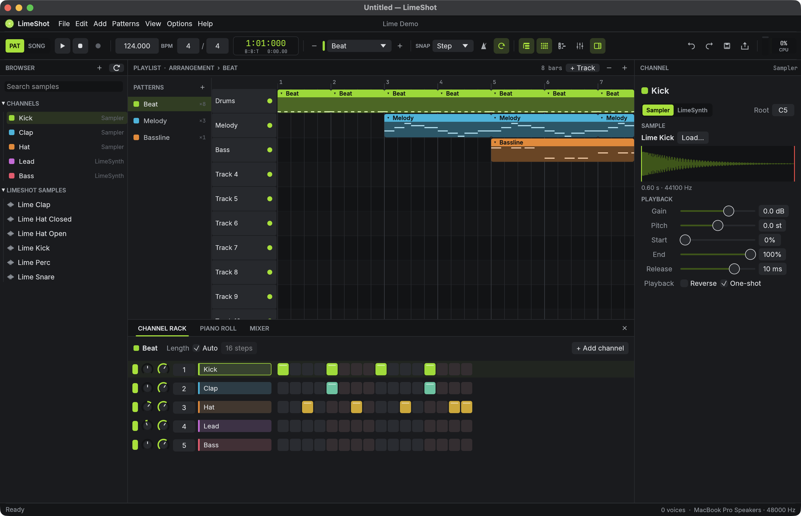
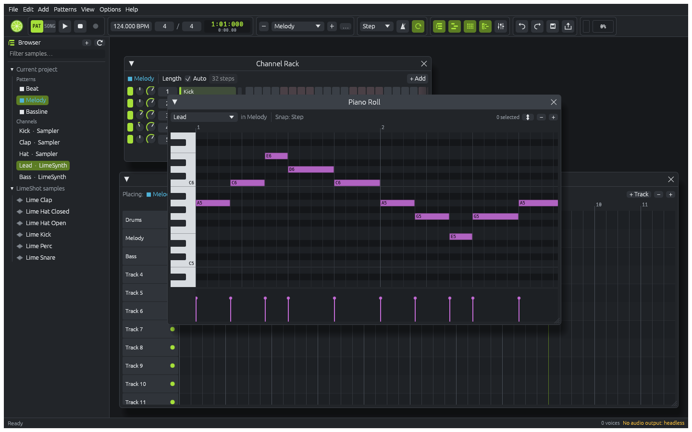
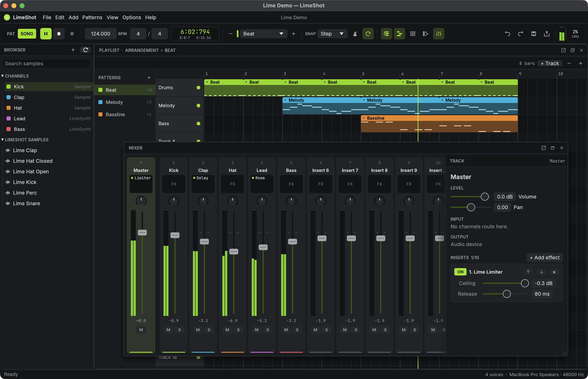
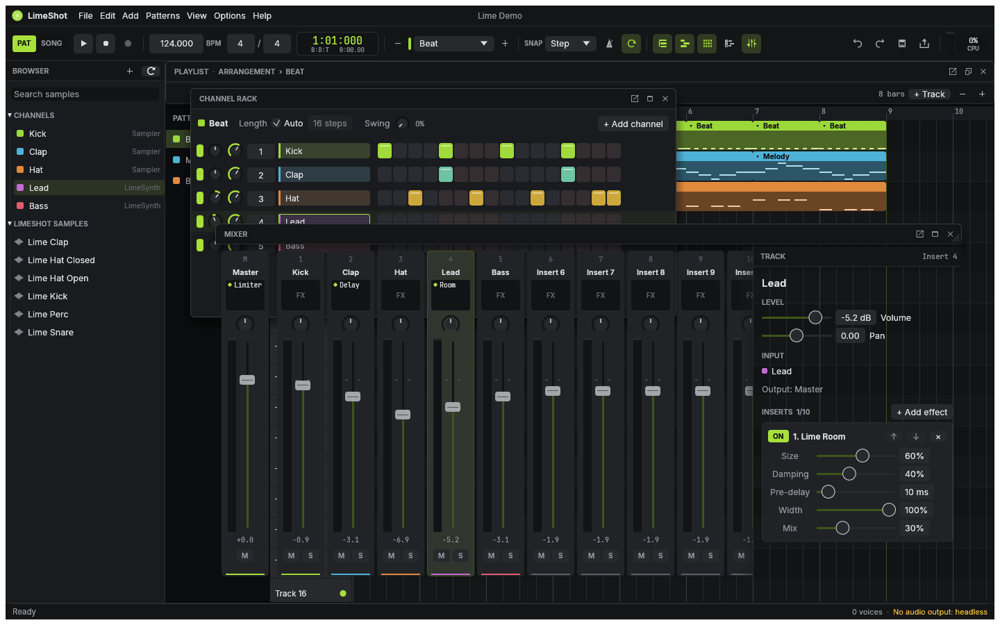
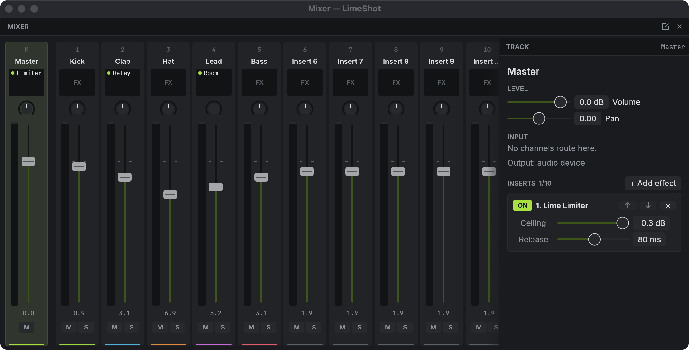

<h1 align="center">LimeShot</h1>

<p align="center"><strong>The pattern-based DAW, in Rust.</strong></p>

<p align="center">
  <a href="https://github.com/fruitapps/limeshot/actions/workflows/ci.yml"></a>
  <a href="Cargo.toml"></a>
  <a href="#project-status"></a>
  <a href="LICENSE"></a>
  <a href="https://github.com/fruitapps/limeshot/stargazers"></a>
</p>

<p align="center">
  <a href="docs/screenshots/live-macos.png"></a>
</p>

<p align="center">
  <a href="#build-from-source">Build from source</a> ·
  <a href="#lime-native-standalone-vst3-suite">Standalone VST3 suite</a> ·
  <a href="docs/roadmap/features.md">Feature inventory</a> ·
  <a href="docs/roadmap/known-limitations.md">Known limitations</a> ·
  <a href="CONTRIBUTING.md">Contributing</a>
</p>

LimeShot is an open-source, offline-first digital audio workstation built around the pattern workflow of FL Studio:
program beats in the Channel Rack, write melodies in the Piano Roll, arrange patterns on the Playlist and mix them on
Mixer inserts. The audio engine, the project model and the native [egui](https://github.com/emilk/egui) interface are
written in Rust. The app runs locally without a web view, account or network connection.

## Make a Beat, Start to Finish

The core composition loop has automated coverage in
[`mvp_workflow.rs`](crates/limeshot-app/tests/mvp_workflow.rs). Click a preview to see it at full size.

| Feature | Preview |
| --- | --- |
| **Channel Rack**<br>Program drums from samples on a step grid, with swing, fill, rotate and channel selection. | <a href="docs/screenshots/main.png"></a> |
| **Piano Roll**<br>Write notes for LimeSynth, the Sampler or a VST3 instrument. It has FL's eight tools, ghost notes, and velocity and pan lanes. | <a href="docs/screenshots/piano-roll.png"></a> |
| **Playlist**<br>Arrange pattern, audio and automation clips. Slip, slice, audio clip fades, time selection, markers and a clip picker. | <a href="docs/screenshots/live-song-mixer.png"></a> |
| **Mixer**<br>Route channels to inserts with volume, pan, a built-in EQ, sidechain compression and up to ten effects per track. | <a href="docs/screenshots/mixer.png"></a> |
| **Workspace windows**<br>Move, resize, maximise and detach editors; F5/F6/F7/F9 toggle Playlist, Rack, Piano Roll and Mixer. | <a href="docs/screenshots/live-mixer-detached.png"></a> |

## Sounds, Effects and Plugins

| Kind | What's included |
| --- | --- |
| **Instruments** | LimeSynth (PolyBLEP oscillators, ADSR, low-pass filter, LFO) and a Sampler with ADSR, trim, reverse, loop points and a low-pass filter; bundled Lime samples and factory presets |
| **Effects** | Lime EQ, Filter, tempo-synced Delay, Room (reverb), Comp (with sidechain), Limiter, Gate, Drive, Chorus (chorus/flanger/phaser) and Utility |
| **Plugins** | VST3 instruments and effects: scanning into a plugin database, state saved in the project, and an internal Plugin / Settings window (macOS native embedding awaits live verification) |
| **Automation** | Song-mode clips for channel/mixer volume and pan, built-in effect and hosted VST3 parameters; point modes and visible automated controls |
| **Recording** | MIDI input and note recording from a device or typing keyboard; audio input recording to Playlist clips is implemented but awaits real-input verification |
| **Files** | `.lime` projects (versioned, atomic save, autosave/recovery), WAV/MP3/FLAC/Ogg Vorbis/AIFF samples, WAV export of a song/pattern/time selection, MIDI import/export and partial FL Studio `.flp` import |

## Project Status

**Early alpha.** LimeShot can compose, arrange, mix, save and render songs, but production readiness and platform
coverage are still being established. Automated tests establish the behavior they exercise; they do not establish
compatibility with every audio device, plugin or host. Existing screenshots illustrate the interface and may predate
newer controls.

The inventory currently tracks **272 features: 149 VERIFIED, 24 IMPLEMENTED, 13 IN_PROGRESS,
81 NOT_STARTED, 1 RESEARCHED and 4 DEFERRED** (2026-10-22). IMPLEMENTED means code exists; VERIFIED additionally
requires listed tests or recorded manual evidence. These counts describe tracked features, not percentage parity
with FL Studio or measured test coverage.

| State tracker | What it records |
| --- | --- |
| [Feature inventory](docs/roadmap/features.md) / [canonical JSON](docs/roadmap/features.json) | Priorities, dependencies, acceptance criteria, implementation states and verification evidence |
| [Menu inventory](docs/roadmap/menus.md) | 730 menu/toolbar/editor entries and their implementation differences |
| [Shortcut inventory](docs/roadmap/keybindings.md) | 143 bindings, including differences and unimplemented shortcuts |
| [Settings inventory](docs/roadmap/settings.md) | 189 controls/settings and their current states |
| [MVP acceptance](docs/roadmap/mvp.md) / [milestones](docs/roadmap/milestones.md) | End-to-end acceptance and delivery scope |
| [Progress log](docs/development/progress.md) / [next steps](docs/development/next-steps.md) | Dated verification records and continuation priorities |
| [Known limitations](docs/roadmap/known-limitations.md) | Outstanding restrictions and manual/platform checks |
| [Live CI](https://github.com/fruitapps/limeshot/actions/workflows/ci.yml) | Build, test and lint results for the actual commit and platform |

Some older continuation/limitation entries predate the recording, decoder, sampler, fade and automation additions;
use the canonical feature record and its latest progress evidence to resolve those historical descriptions.

Still missing or limited: tempo automation, CLAP/AU, stems, templates, remappable shortcuts, automatic workspace
layout persistence, time stretching and several advanced editor actions. Hardware MIDI and audio recording need
hands-on checks; audio recording has no input monitoring or latency compensation. Native macOS VST3 embedding
needs another live resize/tab/keyboard pass; Windows/Linux currently expose plugin parameters. The process bridge
is opt-in and has no native editor. `.flp` import omits plugin state, mixer effects/routing and automation curves;
unsupported generators become LimeSynth. Integer WAV export has no dither; Drive has no oversampling.

## Lime Native Standalone VST3 Suite

**Lime Native** packages two instruments and seven effects as nine independent VST3 plugins. Each has its own
resizable native editor, factory presets, host automation/state and `.limepreset` interchange, with the existing
LimeShot DSP linked into the bundle. LimeShot does not need to be installed or running.

| Plugin | Purpose |
| --- | --- |
| **LimeSynth** | Polyphonic oscillator synth with ADSR, resonant low-pass filter and LFO |
| **Lime Sampler** | Stereo WAV sampler with trim/reverse, root key, audition keyboard and embedded sample recall |
| **Lime Utility** | Gain, stereo width and polarity |
| **Lime EQ** | Three-band EQ with draggable response nodes |
| **Lime Filter** | Resonant low-, band- and high-pass filtering |
| **Lime Delay** | Stereo delay with host-tempo sync |
| **Lime Room** | Algorithmic stereo reverb |
| **Lime Comp** | Compressor with optional external stereo sidechain |
| **Lime Limiter** | Sample-peak limiter with gain-reduction history; no lookahead or true-peak oversampling |

The suite is currently published as source on
[`codex/lime-native-vst3-suite`](https://github.com/fruitapps/limeshot/tree/codex/lime-native-vst3-suite/native-plugins),
**separately from main**. Its
[README](https://github.com/fruitapps/limeshot/blob/codex/lime-native-vst3-suite/native-plugins/README.md),
[validation record](https://github.com/fruitapps/limeshot/blob/codex/lime-native-vst3-suite/native-plugins/VALIDATION.md)
and [third-party notices](https://github.com/fruitapps/limeshot/blob/codex/lime-native-vst3-suite/native-plugins/THIRD_PARTY.md)
cover building, installing, presets and supported targets. To build in a separate checkout (Rust **1.95+**, Python 3
and platform build tools):

```bash
git clone --branch codex/lime-native-vst3-suite https://github.com/fruitapps/limeshot.git limeshot-native
cd limeshot-native
python3 native-plugins/build.py
```

The script collects bundles and a ZIP in `native-plugins/dist/`; it does not install them. Copy the `.vst3` bundles
to your host's plugin directory and rescan. Local validation covers macOS Apple Silicon: all nine pass exported ABI
checks and pluginval 1.0.4 strictness 5, including editor tests. Hands-on DAW checks, Windows/Linux/Intel runtime
validation and notarization remain pending. Local macOS bundles are arm64 and ad-hoc signed. Generated binaries
are build outputs, not files included by cloning Git. VST3-compatible hosts are required; Logic Pro needs AU.
The suite exports these nine plugins; the DAW's Gate, Drive and Chorus are additional built-in effects.

## Platforms

| Platform | State |
| --- | --- |
| macOS Apple Silicon | Built, all tests pass, GUI, realtime audio and VST3 processing tested; new native editor embedding unverified |
| macOS Intel | Native headless CI passes; earlier Rosetta render matched arm64; GUI/audio-device checks remain open |
| Windows x86-64 / ARM64 | x86-64 headless CI and ARM64 cross-build pass; native GUI/audio checks remain open |
| Linux x86-64 / ARM64 | Native headless CI passes; GUI/audio-device checks remain open |

Commit-specific CI evidence is recorded in [platform-validation.md](docs/development/platform-validation.md);
successful results apply to the listed commits, and later commits need their own CI runs.

## Build from Source

The DAW manifest declares Rust 1.88 or newer; current development/CI uses stable Rust.
The separate Lime Native workspace requires Rust 1.95 or newer. On Linux, install the ALSA and windowing headers first:

```bash
sudo apt install libasound2-dev libxkbcommon-dev libwayland-dev libx11-dev \
  libxcursor-dev libxrandr-dev libxi-dev libgl1-mesa-dev libgtk-3-dev mesa-vulkan-drivers
```

Run the app, or open the bundled demo song:

```bash
git clone https://github.com/fruitapps/limeshot.git
cd limeshot
cargo run --release -p limeshot-app
cargo run --release -p limeshot-app -- --demo
```

Press **Space** to play, **L** to switch between Pattern and Song mode, **F5/F6/F7/F9** to toggle the Playlist/Rack/Piano Roll/Mixer and **F1** to see
every shortcut. Enable typing-keyboard notes in the toolbar to play the selected Channel Rack instrument;
Cmd+T toggles this outside the Playlist (where it adds a marker).

On macOS, `bash scripts/package-macos.sh` builds an app and DMG in `dist/`. These are ad-hoc signed development
packages; Developer ID signing and notarization are pending. Windows/Linux installers are not yet provided.

<details>
<summary><strong>Headless CLI</strong></summary>

```bash
mkdir -p out
cargo run --release -p limeshot-app --bin limeshot-cli -- demo out/demo.lime --render out/demo.wav
cargo run --release -p limeshot-app --bin limeshot-cli -- import-flp song.flp out/song.lime
cargo run --release -p limeshot-app --bin limeshot-cli -- midi out/demo.lime out/demo.mid
```

`limeshot-cli` also has `info`, `render`, `play` (realtime through the audio device), `import-midi` and `run`. `run`
applies a JSON list of the same typed commands the UI uses:

```json
[{"SetTempo": 128000}, {"AddPattern": {"name": "Verse"}}]
```

</details>

<details>
<summary><strong>Tests</strong></summary>

```bash
cargo test --workspace
cargo clippy --workspace --all-targets -- -D warnings
cargo fmt --all -- --check
python3 scripts/features.py check
python3 scripts/check_repository.py
```

The suite covers musical timing, scheduling across buffer sizes and sample rates, synth and sampler behaviour,
effects, mixing, VST3 hosting, project round trips, undo and redo, and the editors driven with synthetic input.

</details>

## Architecture

| Crate | What it does |
| --- | --- |
| `limeshot-core` | Musical time (960 PPQ ticks), the project model, typed commands, undo and redo |
| `limeshot-project` | `.lime` files (versioned envelope, migrations, atomic saving), MIDI, and `.flp` import |
| `limeshot-dsp` | Oscillators, envelopes, effect processors, pan law and audio decoding/WAV writing |
| `limeshot-sequencer` | Compiles a project into an immutable playback snapshot |
| `limeshot-engine` | The renderer (voices, scheduling, mixer, transport, effects), shared by playback and export |
| `limeshot-audio` | cpal device output/input recording, MIDI input, lock-free control and background sample loading |
| `limeshot-plugins` | VST3 hosting: loading, scanning, processing, state and editor windows |
| `limeshot-ui` | The egui interface: toolbar, browser, Channel Rack, Piano Roll, Playlist, Mixer, windows |
| `limeshot-app` | The `limeshot` desktop app and `limeshot-cli` |

For contributor setup, regression tests, real-time constraints, plugin compatibility and pull requests, read
[CONTRIBUTING.md](CONTRIBUTING.md). Agent-specific guidance remains in [AGENTS.md](AGENTS.md).

## Documentation

- [Contributing](CONTRIBUTING.md)
- [Architecture](docs/architecture/): audio engine, project model and UI
- [Design decisions](docs/development/decisions.md)
- [Roadmap and feature inventory](docs/roadmap/)
- [Research](docs/research/): how the reference application was studied
- [Working on LimeShot with agents](AGENTS.md)

## License

LimeShot is dual-licensed under [MIT](LICENSE-MIT) or [Apache-2.0](LICENSE-APACHE), at your option. Bundled assets are
listed in [ATTRIBUTION.md](ATTRIBUTION.md).

LimeShot is independent and not affiliated with Image-Line. FL Studio is a trademark of Image-Line. No FL Studio code,
artwork, samples or presets are used. The reference application was studied only through its documentation, metadata
and observable behaviour (see [docs/research/](docs/research/)).

## Star History

[](https://www.star-history.com/?repos=fruitapps%2Flimeshot&type=date&legend=top-left)

GitHub badges and the star-history chart are external README services and become useful once the repository is
public. They are separate from the offline application.
