<h1 align="center">LimeShot</h1>

<p align="center"><strong>The pattern-based DAW, in Rust.</strong></p>

<p align="center">
  <a href="https://github.com/fruitapps/limeshot/releases"></a>
  <a href="https://github.com/fruitapps/limeshot/actions/workflows/ci.yml"></a>
  <a href="Cargo.toml"></a>
  <a href="LICENSE"></a>
  <a href="https://github.com/fruitapps/limeshot/stargazers"></a>
</p>

<p align="center">
  <a href="docs/screenshots/current/workspace.png">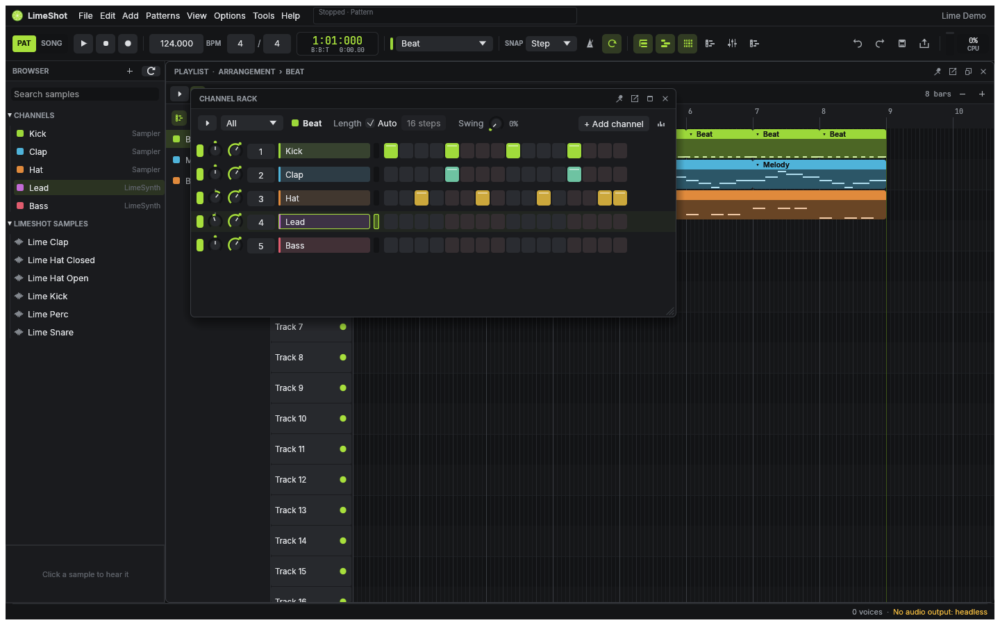</a>
</p>

<p align="center">
  <a href="#install">Install</a> ·
  <a href="#first-steps">First steps</a> ·
  <a href="#build-from-source">Build from source</a> ·
  <a href="#lime-native-vst3-suite">Lime Native VST3s</a> ·
  <a href="docs/roadmap/known-limitations.md">Known limitations</a> ·
  <a href="CONTRIBUTING.md">Contributing</a>
</p>

LimeShot is an open-source, offline-first digital audio workstation built around the pattern workflow of FL Studio:
program beats in the Channel Rack, write melodies in the Piano Roll, arrange patterns on the Playlist and mix them on
Mixer inserts. The audio engine, the project model and the native [egui](https://github.com/emilk/egui) interface are
written in Rust. It runs locally without a web view, account or network connection.

> **Alpha.** [v0.1.0-alpha.1](https://github.com/fruitapps/limeshot/releases/tag/v0.1.0-alpha.1) is the first
> prerelease. You can compose, arrange, mix, save and export songs, but expect rough edges: save often, and please
> [open an issue](https://github.com/fruitapps/limeshot/issues) when something breaks.

## Install

Download the package for your system from the
[latest release](https://github.com/fruitapps/limeshot/releases/latest). Every package contains LimeShot, the
command-line tool `limeshot-cli`, the bundled samples and the twelve [Lime Native VST3s](#lime-native-vst3-suite)
that LimeShot's instruments and effects run on.

| System | Package | What it installs |
| --- | --- | --- |
| Windows 10/11 x64 | `LimeShot-<version>-windows-x64-setup.exe` | LimeShot in Program Files (or just for you), the Lime VST3s in `Common Files\VST3`, `.lime` file association, uninstaller |
| | `LimeShot-<version>-windows-x64-portable.zip` | Nothing: unzip anywhere and run `limeshot.exe` |
| macOS 11+ Apple Silicon | `LimeShot-<version>-macos-arm64.pkg` | `/Applications/LimeShot.app` and the Lime VST3s in `/Library/Audio/Plug-Ins/VST3` |
| | `LimeShot-<version>-macos-arm64.dmg` | Drag `LimeShot.app` to Applications; the VST3s stay inside the app |
| macOS 11+ Intel | `…-macos-x86_64.pkg` / `…-macos-x86_64.dmg` | As above |
| Linux x86-64 / ARM64 (Debian, Ubuntu) | `limeshot_<version>_amd64.deb` / `_arm64.deb` | `/opt/limeshot`, `limeshot` and `limeshot-cli` on the path, the Lime VST3s in `/usr/lib/vst3`, a desktop entry |
| Linux x86-64 / ARM64 (any glibc 2.35+) | `limeshot-<version>-linux-x86_64.tar.gz` / `-linux-aarch64.tar.gz` | Runs in place, or installs with `install.sh` |

The packages are not signed with a developer identity yet, so your system will warn the first time:

<details>
<summary><strong>Windows</strong></summary>

Run the installer. If SmartScreen says "Windows protected your PC", choose **More info › Run anyway**. The
installer lets you install for all users or only for yourself; unticking the VST3 component keeps the Lime VST3s
private to LimeShot instead of sharing them with other hosts. Uninstall from **Settings › Apps**.

</details>

<details>
<summary><strong>macOS</strong></summary>

Open the PKG, or open the DMG and drag LimeShot to Applications. Because the app is signed ad hoc, macOS blocks it
the first time: right-click (or Control-click) the PKG or `LimeShot.app` and choose **Open**, or allow it under
**System Settings › Privacy & Security**. Microphone access is requested only when you record audio.

To uninstall, delete `/Applications/LimeShot.app`; a PKG install also put the `Lime*.vst3` bundles in
`/Library/Audio/Plug-Ins/VST3`.

</details>

<details>
<summary><strong>Linux</strong></summary>

Debian or Ubuntu:

```bash
sudo apt install ./limeshot_0.1.0-alpha.1_amd64.deb   # or _arm64.deb
limeshot
sudo apt remove limeshot                               # uninstall
```

Any other distribution, with the tarball:

```bash
tar -xzf limeshot-0.1.0-alpha.1-linux-x86_64.tar.gz
cd limeshot-0.1.0-alpha.1-linux-x86_64
./limeshot                # run in place, or install:
sudo ./install.sh         # /opt/limeshot, VST3s in /usr/local/lib/vst3
./install.sh --user       # ~/.local/opt/limeshot, VST3s in ~/.vst3
```

Add `--private-plugins` to keep the VST3s out of the shared folders; `uninstall.sh` in the installed folder
removes everything. LimeShot needs ALSA, OpenGL and libxkbcommon on X11 or Wayland; file dialogs use the XDG desktop
portal. On Linux, plugin editors are not embedded yet: plugins show their parameters instead.

</details>

To check a download, compare it with `SHA256SUMS.txt` from the same release:

```bash
sha256sum -c SHA256SUMS.txt --ignore-missing    # macOS: shasum -a 256 -c SHA256SUMS.txt --ignore-missing
```

## First steps

To hear a short demo song, start LimeShot with `--demo`: `limeshot --demo` on Linux, `limeshot.exe --demo` on
Windows, `open -a LimeShot --args --demo` on macOS.

| Key | Action |
| --- | --- |
| **Space** | Play / stop |
| **L** | Switch between Pattern and Song mode |
| **F5 / F6 / F7 / F9** | Show or hide the Playlist, Channel Rack, Piano Roll and Mixer |
| **Cmd/Ctrl+S**, **Cmd/Ctrl+R** | Save, export WAV (Cmd/Ctrl+Shift+R for MP3) |
| **F1** | List every shortcut |

Drag samples from the Browser onto the Channel Rack or the Playlist. Turn on typing-keyboard notes in the toolbar to
play the selected instrument from your computer keyboard (Cmd/Ctrl+T outside the Playlist). To use your own VST3
plugins, choose **Plugins › Find plugins…** in the Channel Rack's or an insert's Add menu once; the scanned plugins
are then listed there.

## Make a Beat, Start to Finish

The core loop has an automated end-to-end test,
[`mvp_workflow.rs`](crates/limeshot-app/tests/mvp_workflow.rs). Click a preview to see it at full size.

| Feature | Preview |
| --- | --- |
| **Channel Rack**<br>Program drums from samples on a step grid, with swing, fill, rotate and channel selection. | <a href="docs/screenshots/current/rack.png">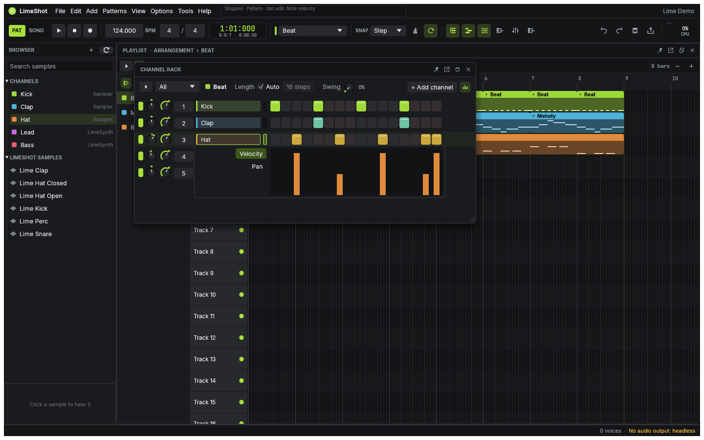</a> |
| **Piano Roll**<br>Write notes for LimeSynth, Lime Sampler or any VST3 instrument, with FL's eight tools, ghost notes, and velocity and pan lanes. | <a href="docs/screenshots/current/piano-roll.png">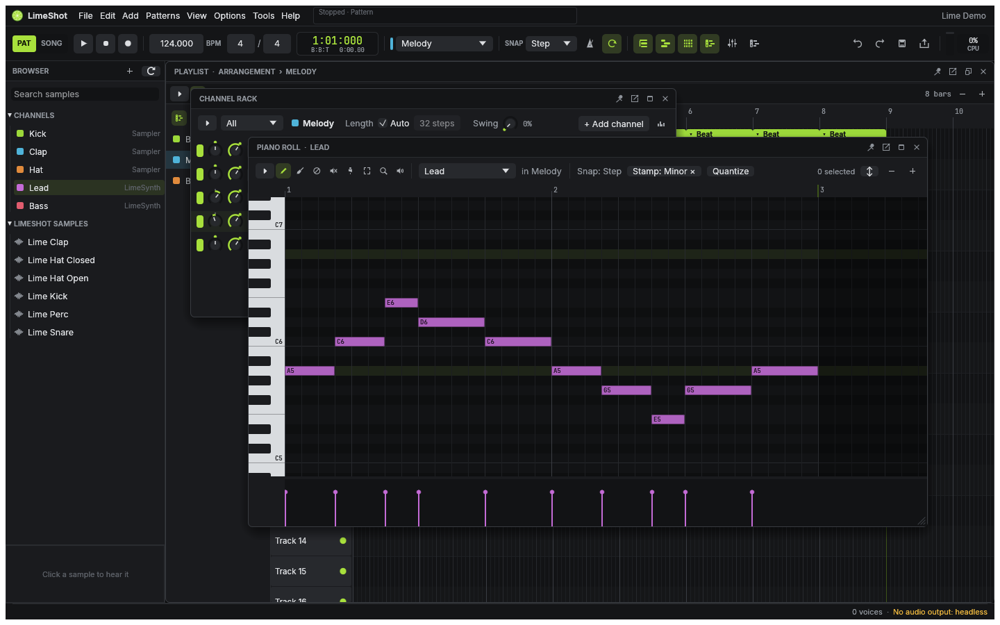</a> |
| **Playlist**<br>Arrange pattern, audio and automation clips. Slip, slice, audio clip fades, time selection, markers and a clip picker. | <a href="docs/screenshots/current/audio-clips.png">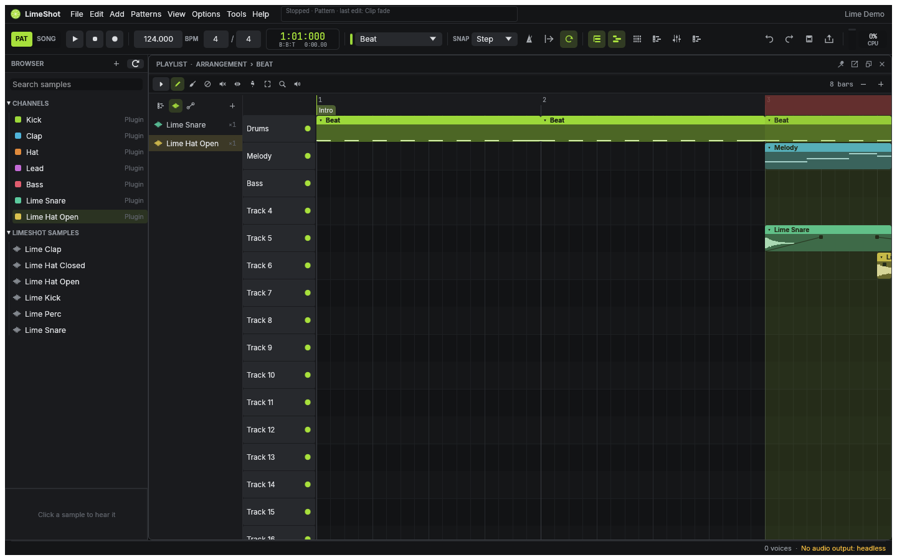</a> |
| **Mixer**<br>Route channels to inserts with volume, pan, a three-band track EQ, sidechain compression and up to ten effects per track. | <a href="docs/screenshots/current/mixer.png">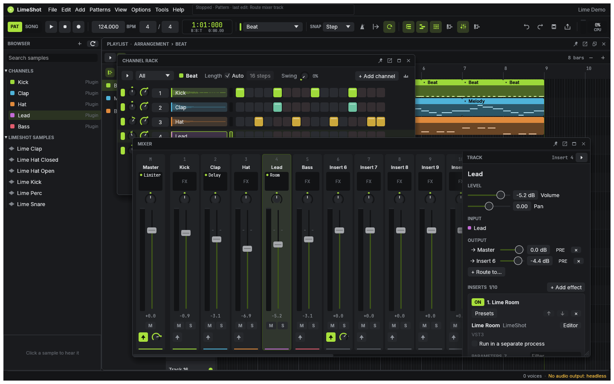</a> |
| **Workspace windows**<br>Move, resize, maximise and detach editors, as in FL Studio. | <a href="docs/screenshots/current/workspace.png"></a> |
| **Automation**<br>Shape Song-mode automation with curves, stairs and waves. | <a href="docs/screenshots/current/automation.png">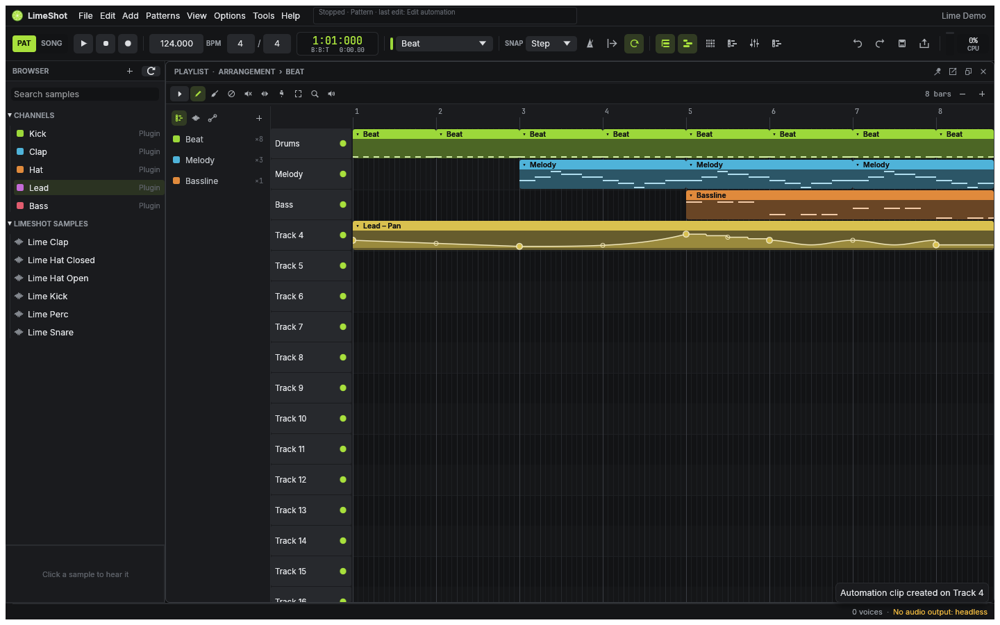</a> |
| **Sampler**<br>Inspect the waveform and adjust playback, loop and filter settings. | <a href="docs/screenshots/current/sampler.png">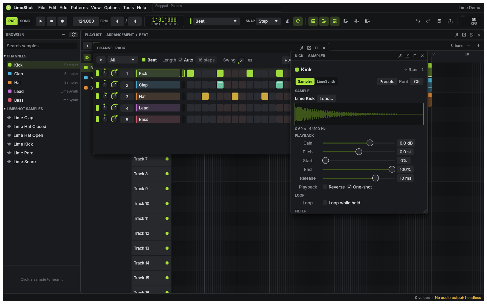</a> |
| **LimeSynth**<br>Edit oscillators, envelopes, filtering and modulation. | <a href="docs/screenshots/current/synth.png">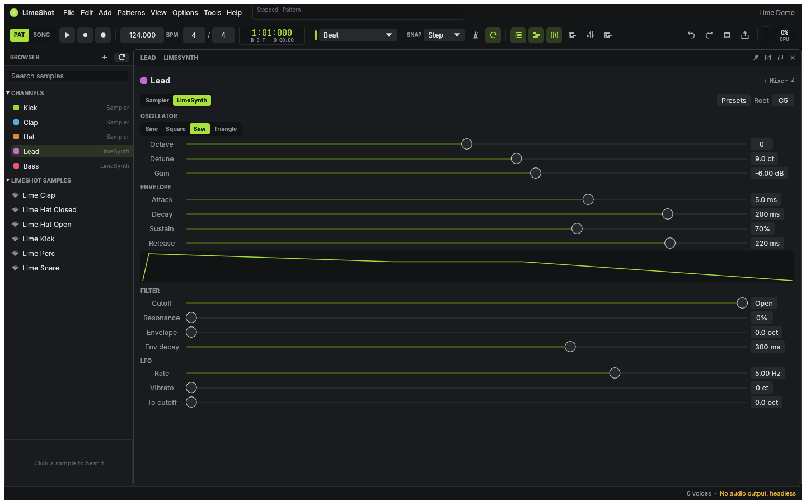</a> |
| **Mixer EQ**<br>Shape the selected insert with the inline three-band EQ. | <a href="docs/screenshots/current/mixer-eq.png">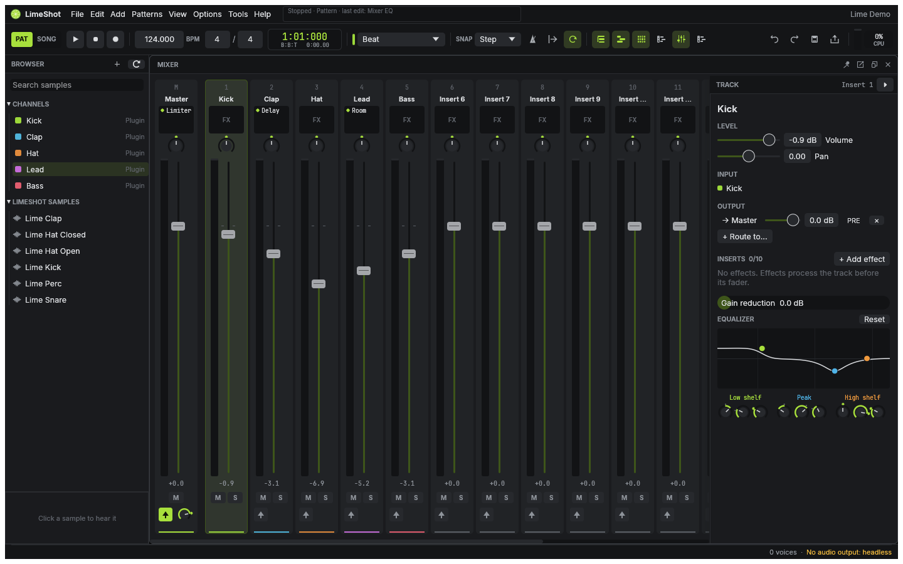</a> |
| **Audio export**<br>Choose the render range, sample rate, WAV bit depth or MP3 bitrate. | <a href="docs/screenshots/current/export-mp3.png">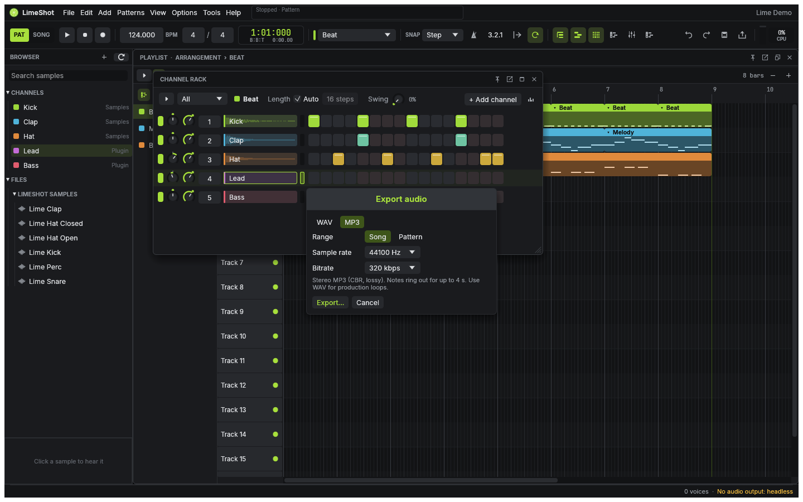</a> |

## Sounds, Effects and Plugins

| Kind | What's included |
| --- | --- |
| **Instruments** | LimeSynth (PolyBLEP oscillators, ADSR, low-/band-/high-pass filter, LFO) and Lime Sampler (ADSR, trim, reverse, loop points, low-pass filter; samples up to about 125 s at 48 kHz); bundled Lime samples and factory presets |
| **Effects** | Lime EQ, Filter, tempo-synced Delay, Room (reverb), Comp (with sidechain), Limiter, Gate, Drive, Chorus (chorus/flanger/phaser) and Utility |
| **Plugins** | VST3 instruments and effects: a scanned plugin database, state saved in the project, plugin editors in LimeShot windows (macOS and Windows), presets, automation, delay compensation and an optional separate process per plugin |
| **Automation** | Song-mode clips for channel/mixer volume and pan, tempo and VST3 parameters; point modes; automated controls move |
| **Recording** | MIDI input and note recording from a device or the typing keyboard; audio recording to Playlist clips |
| **Files** | `.lime` projects (versioned, atomic save, autosave/recovery), WAV/MP3/FLAC/Ogg Vorbis/AIFF samples, WAV/MP3 export of a song/pattern/time selection, MIDI import/export and partial FL Studio `.flp` import |

Not there yet: CLAP/AU plugins, stems, templates, remappable shortcuts, time stretching and many advanced editor
actions. Hardware MIDI and audio recording still need hands-on checks; audio recording has no input monitoring or
latency compensation. `.flp` import leaves out plugin state, mixer effects and routing, and automation curves. The
full list is in [known limitations](docs/roadmap/known-limitations.md).

## Project Status

The [feature inventory](docs/roadmap/features.md) tracks 292 features against FL Studio, each with its acceptance
criteria and evidence: IMPLEMENTED means the code exists, VERIFIED that listed tests or recorded manual checks pass.
These are tracked features, not a percentage of parity with FL Studio.

| Platform | State |
| --- | --- |
| macOS Apple Silicon | CI passes; GUI, realtime audio and VST3 processing used by hand; native plugin embedding partly verified |
| macOS Intel | CI passes; GUI and audio devices not exercised by hand |
| Windows x64 | CI passes; GUI and plugin editors used by hand, no systematic pass yet |
| Linux x86-64 / ARM64 | CI passes; GUI and audio devices not exercised by hand |

| Tracker | What it records |
| --- | --- |
| [Feature inventory](docs/roadmap/features.md) / [canonical JSON](docs/roadmap/features.json) | Priorities, dependencies, acceptance criteria, states and evidence |
| [Menus](docs/roadmap/menus.md), [shortcuts](docs/roadmap/keybindings.md), [settings](docs/roadmap/settings.md) | FL Studio's menu items, shortcuts and settings against LimeShot's |
| [Known limitations](docs/roadmap/known-limitations.md) | What does not work yet, or is not verified |
| [Next steps for agents](docs/development/next-steps.md) | Development priorities and FL Studio parity work |
| [Human verification needed](docs/development/human-verification.md) / [progress log](docs/development/progress.md) | Hands-on checks, owner decisions and dated evidence |
| [Platform validation](docs/development/platform-validation.md) | CI and hands-on evidence per platform |

## Lime Native VST3 Suite

**Lime Native** is two instruments and ten effects as twelve independent VST3 plugins. LimeShot uses them as its
instruments and effects, and they work in any VST3 host (FL Studio, REAPER, Cubase, Ableton Live, Bitwig; Logic Pro
needs AU). Each has its own resizable editor, factory presets, host automation and state, and `.limepreset`
interchange. The LimeShot installers put them in your system's VST3 folder, so other hosts find them after a rescan.

| | | |
| --- | --- | --- |
| <a href="docs/screenshots/current/native/limesynth.png">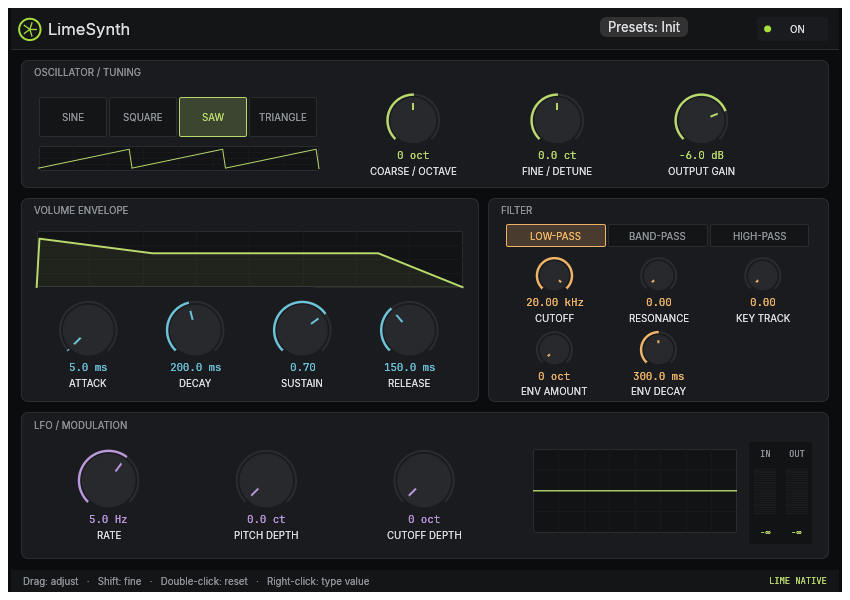</a><br>**LimeSynth** | <a href="docs/screenshots/current/native/lime-sampler.png">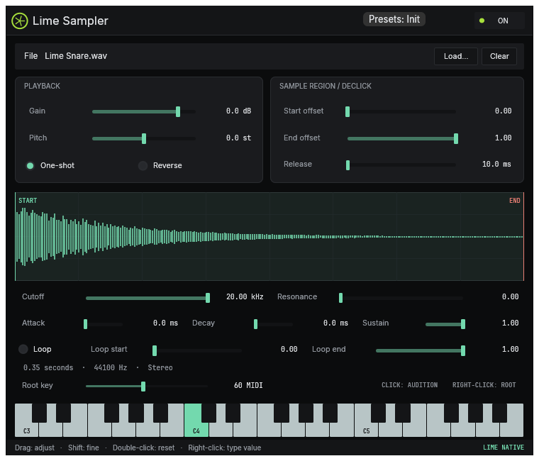</a><br>**Lime Sampler** | <a href="docs/screenshots/current/native/lime-utility.png">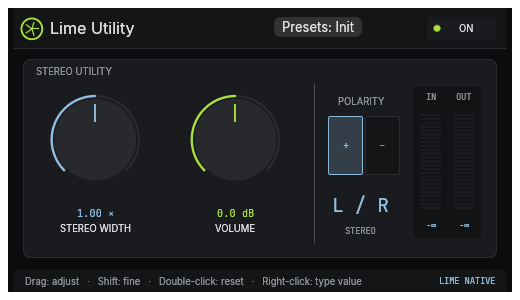</a><br>**Lime Utility** |
| <a href="docs/screenshots/current/native/lime-eq.png">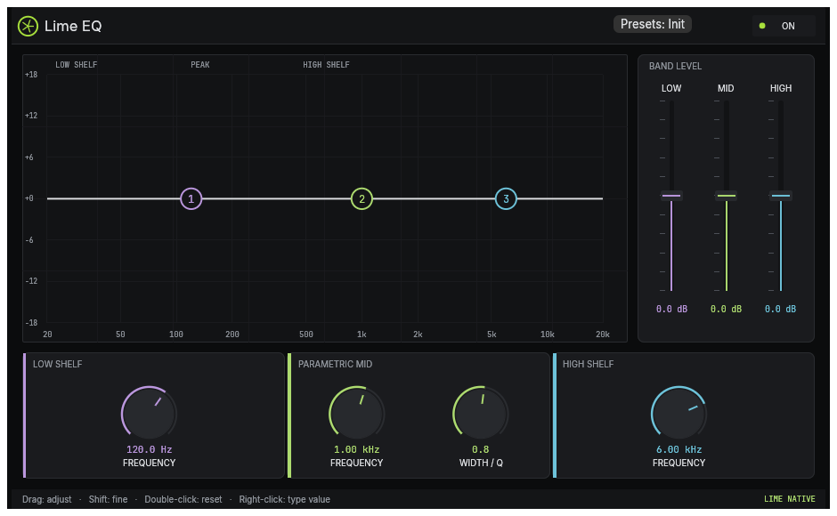</a><br>**Lime EQ** | <a href="docs/screenshots/current/native/lime-filter.png">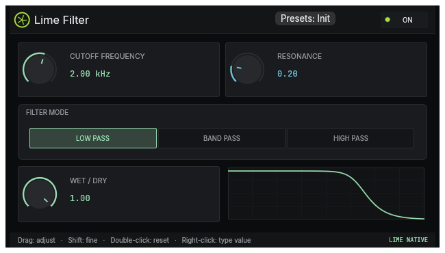</a><br>**Lime Filter** | <a href="docs/screenshots/current/native/lime-delay.png">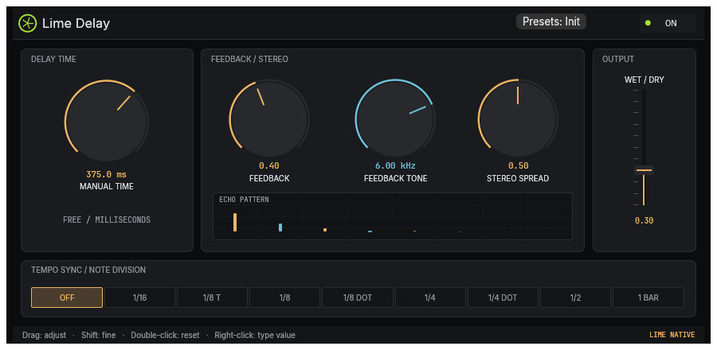</a><br>**Lime Delay** |
| <a href="docs/screenshots/current/native/lime-room.png">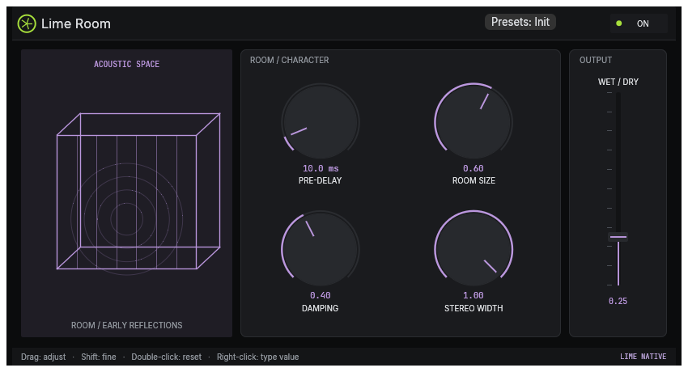</a><br>**Lime Room** | <a href="docs/screenshots/current/native/lime-comp.png">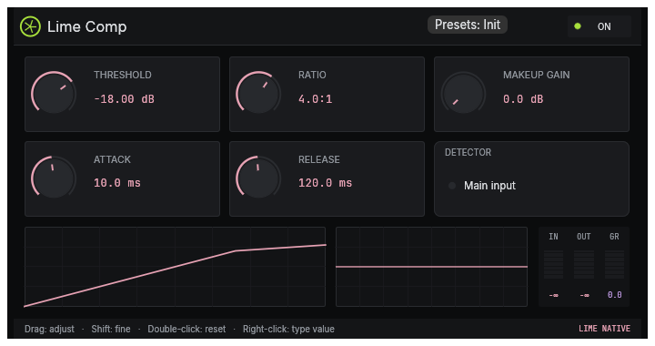</a><br>**Lime Comp** | <a href="docs/screenshots/current/native/lime-limiter.png">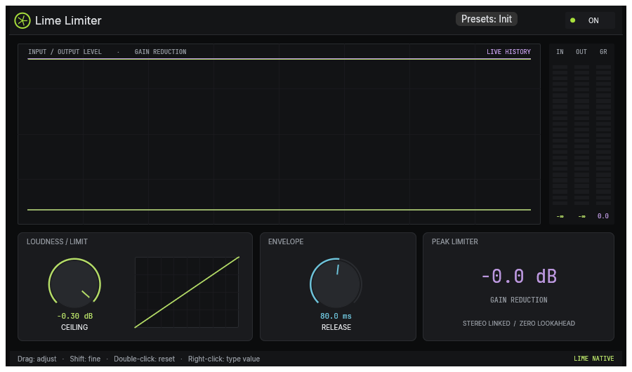</a><br>**Lime Limiter** |
| <a href="docs/screenshots/current/native/lime-gate.png">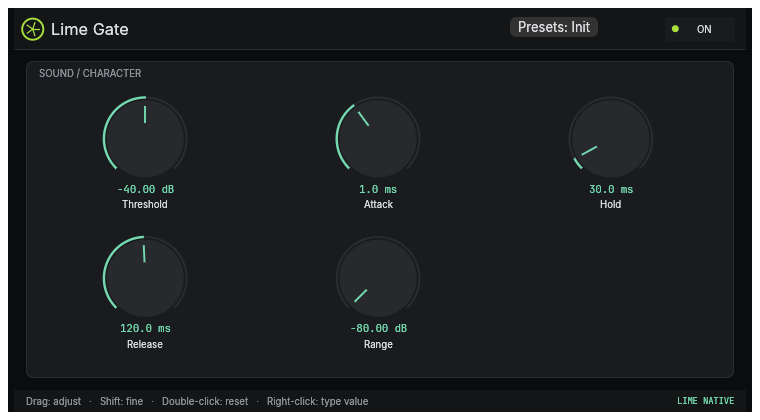</a><br>**Lime Gate** | <a href="docs/screenshots/current/native/lime-drive.png">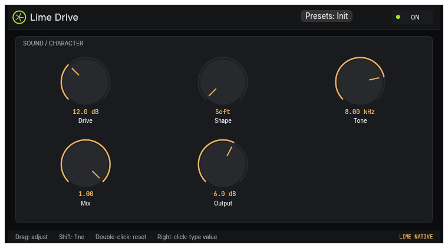</a><br>**Lime Drive** | <a href="docs/screenshots/current/native/lime-chorus.png">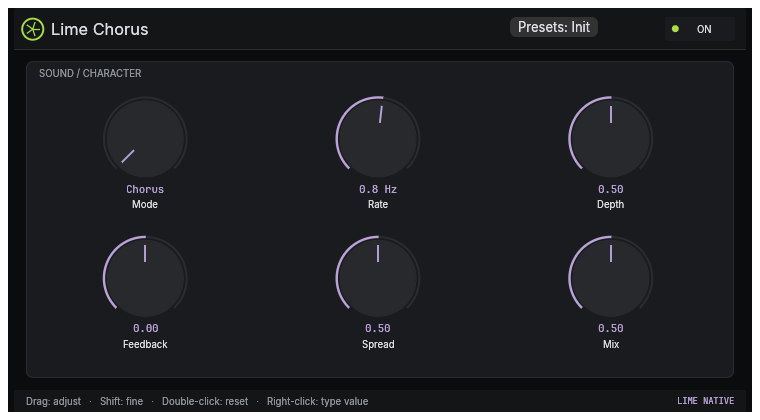</a><br>**Lime Chorus** |

| Plugin | Purpose |
| --- | --- |
| **LimeSynth** | Polyphonic oscillator synth with ADSR, resonant low-/band-/high-pass filter, key tracking and LFO |
| **Lime Sampler** | Stereo sampler (WAV, MP3, FLAC, Ogg Vorbis, AIFF) with trim/reverse, root key, audition keyboard and embedded sample recall |
| **Lime Utility** | Gain, stereo width and polarity |
| **Lime EQ** | Three-band EQ with draggable response nodes |
| **Lime Filter** | Resonant low-, band- and high-pass filtering |
| **Lime Delay** | Stereo delay with host-tempo sync |
| **Lime Room** | Algorithmic stereo reverb |
| **Lime Comp** | Compressor with optional external stereo sidechain |
| **Lime Limiter** | Sample-peak limiter with gain-reduction history; no lookahead or true-peak oversampling |
| **Lime Gate** | Noise gate with hold and adjustable range |
| **Lime Drive** | Soft/hard clipping and wave folding with tone and mix |
| **Lime Chorus** | Chorus, flanger and phaser modes |

The suite lives in [`native-plugins/`](native-plugins/README.md); its [validation record](native-plugins/VALIDATION.md)
and [third-party notices](native-plugins/THIRD_PARTY.md) are alongside.

## Build from Source

The DAW needs Rust 1.88 or newer and the Lime Native workspace Rust 1.95 or newer; development and CI use current
stable Rust. You also need Python 3 and your platform's C/C++ build tools. On Linux, install the ALSA and windowing
headers first:

```bash
sudo apt install build-essential pkg-config libasound2-dev libxkbcommon-dev libwayland-dev libx11-dev \
  libxcursor-dev libxrandr-dev libxi-dev libgl1-mesa-dev libgtk-3-dev mesa-vulkan-drivers
```

Build the Lime VST3s once (LimeShot plays through them), then run the app or the demo song:

```bash
git clone https://github.com/fruitapps/limeshot.git
cd limeshot
python3 native-plugins/build.py
cargo run --release -p limeshot-app
cargo run --release -p limeshot-app -- --demo
```

`scripts/package-windows.ps1`, `scripts/package-macos.sh` and `scripts/package-linux.sh` build the installers
above into `dist/`; see [release packaging](docs/development/release-packaging.md).

<details>
<summary><strong>Headless CLI</strong></summary>

```bash
mkdir -p out
cargo run --release -p limeshot-app --bin limeshot-cli -- demo out/demo.lime --render out/demo.wav
cargo run --release -p limeshot-app --bin limeshot-cli -- import-flp song.flp out/song.lime
cargo run --release -p limeshot-app --bin limeshot-cli -- midi out/demo.lime out/demo.mid
```

For MP3, use `render song.lime song.mp3 --rate 48000 --bitrate 192` (stereo CBR, 32–320 kbps).
Use WAV for aligned production loops; MP3 reimport can retain codec padding.

`limeshot-cli` also has `info`, `render`, `play` (realtime through the audio device), `import-midi` and `run`. `run`
applies a JSON list of the same typed commands the UI uses:

```json
[{"SetTempo": 128000}, {"AddPattern": {"name": "Verse"}}]
```

Opening a project does not embed audio from outside its folder automatically. Choose the source in the GUI, or
pass `--allow-external-samples` to the CLI when you mean to include those recordings.

</details>

<details>
<summary><strong>Tests</strong></summary>

```bash
cargo test --workspace
cargo clippy --workspace --all-targets -- -D warnings
cargo fmt --all -- --check
python3 scripts/features.py check
python3 scripts/check_repository.py
```

The suite covers musical timing, scheduling across buffer sizes and sample rates, synth and sampler behaviour,
effects, mixing, VST3 hosting, project round trips, undo and redo, and the editors driven with synthetic input.

</details>

## Architecture

| Crate | What it does |
| --- | --- |
| `limeshot-core` | Musical time (960 PPQ ticks), the project model, typed commands, undo and redo |
| `limeshot-project` | `.lime` files (versioned envelope, migrations, atomic saving), MIDI, and `.flp` import |
| `limeshot-dsp` | Oscillators, envelopes, effect processors, pan law and audio decoding/WAV writing |
| `limeshot-sequencer` | Compiles a project into an immutable playback snapshot |
| `limeshot-engine` | The renderer (scheduling, mixer, transport, plugin hosting), shared by playback and export |
| `limeshot-audio` | cpal device output/input recording, MIDI input, lock-free control and background sample loading |
| `limeshot-plugins` | VST3 hosting: loading, scanning, processing, state and editor windows |
| `limeshot-ui` | The egui interface: toolbar, browser, Channel Rack, Piano Roll, Playlist, Mixer, windows |
| `limeshot-app` | The `limeshot` desktop app and `limeshot-cli` |

Design notes: [architecture](docs/architecture/) (audio engine, project model, UI) and
[design decisions](docs/development/decisions.md). Research on the reference application is in
[docs/research/](docs/research/).

## Contributing

Bug reports, device and plugin checks, and pull requests are welcome; read [CONTRIBUTING.md](CONTRIBUTING.md) first.
Instructions for coding agents are in [AGENTS.md](AGENTS.md).

## License

LimeShot is dual-licensed under [MIT](LICENSE-MIT) or [Apache-2.0](LICENSE-APACHE), at your option. Bundled assets are
listed in [ATTRIBUTION.md](ATTRIBUTION.md).

LimeShot is independent and not affiliated with Image-Line. FL Studio is a trademark of Image-Line. No FL Studio code,
artwork, samples or presets are used. The reference application was studied only through its documentation, metadata
and observable behaviour (see [docs/research/](docs/research/)).

## Star History

[](https://www.star-history.com/?repos=fruitapps%2Flimeshot&type=date&legend=top-left)
