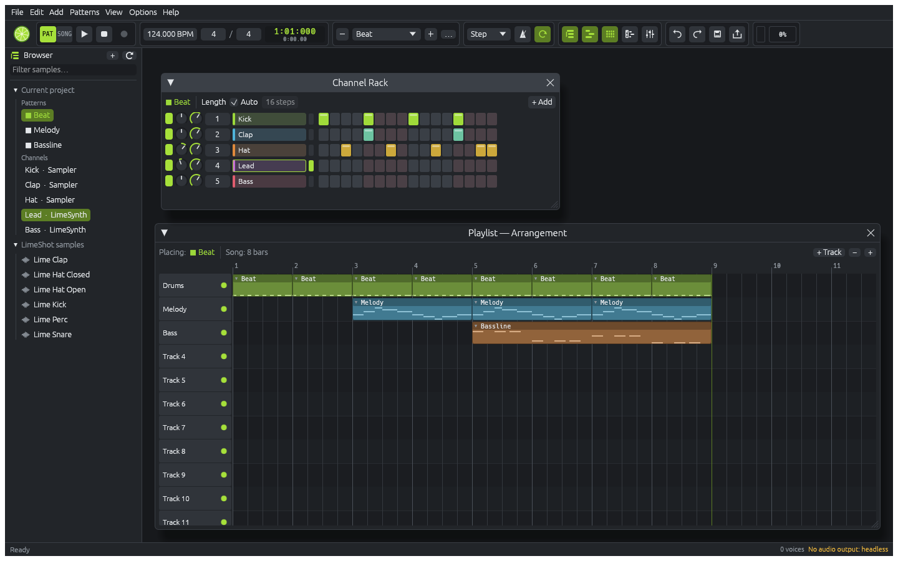

# LimeShot

An open-source, offline-first, pattern-based digital audio workstation written in Rust.

LimeShot follows the production workflow of FL Studio (Channel Rack step sequencer, Piano Roll, pattern
clips on a Playlist, Mixer inserts) with its own implementation, look and name. Everything is Rust: the
audio engine, the project model and the native egui user interface. No web view, no account, no network.



## Status

**Early, but the core workflow works end to end.** You can build drums from WAV samples in the Channel
Rack, write melodies for the built-in synth in the Piano Roll, arrange several patterns on the Playlist,
route channels to mixer tracks, set volume and pan, save and reopen `.lime` projects, and export WAV. This
is checked by an automated end-to-end test (`crates/limeshot-app/tests/mvp_workflow.rs`) and by realtime
playback on macOS.

Not there yet: effects, automation, recording, MIDI devices, plugin hosting, audio clips, MP3/FLAC export.
See [docs/roadmap/known-limitations.md](docs/roadmap/known-limitations.md) and the full inventory of
217 tracked features in [docs/roadmap/features.md](docs/roadmap/features.md).

| Platform | State |
|---|---|
| macOS Apple Silicon | Built, all tests pass, GUI and realtime audio verified |
| macOS Intel | Release build runs (Rosetta); headless render bit-identical to arm64; GUI not exercised |
| Windows x86-64 / ARM64 | Type-checks (`cargo check --target …`); CI jobs defined, not yet run |
| Linux x86-64 / ARM64 | CI jobs defined, not yet run |

## Build and run

Requires a stable Rust toolchain (1.88 or newer). On Linux install ALSA and windowing headers first:
`sudo apt install libasound2-dev libxkbcommon-dev libwayland-dev libx11-dev libgtk-3-dev`.

```bash
cargo run --release -p limeshot-app
```

```bash
cargo run --release -p limeshot-app -- --demo
```

The second command opens a short demo song made from the bundled samples. Press **Space** to play,
**L** to switch Pattern/Song mode, **F5–F9** to toggle windows, **F1** for all shortcuts.

### Headless CLI

```bash
cargo run --release -p limeshot-app --bin limeshot-cli -- demo out/demo.lime --render out/demo.wav
```

`limeshot-cli` also has `info`, `render`, `play` (realtime through the audio device) and `run`, which
applies a JSON list of the same typed commands the UI uses:

```json
[{"SetTempo": 128000}, {"AddPattern": {"name": "Verse"}}]
```

### Tests

```bash
cargo test --workspace
```

The suite (72 tests) covers musical timing, scheduling across buffer sizes and sample rates,
synth/sampler behaviour, mixing, project round trips, undo/redo, and the UI driven with synthetic input.

## Layout

| Crate | Purpose |
|---|---|
| `limeshot-core` | Musical time (960 PPQ ticks), project model, typed commands, undo/redo |
| `limeshot-project` | `.lime` file format: versioned envelope, migrations, atomic saving |
| `limeshot-dsp` | Oscillators, envelopes, pan law, WAV I/O |
| `limeshot-sequencer` | Compiles a project into an immutable playback snapshot |
| `limeshot-engine` | Renderer (voices, scheduling, mixer, transport) shared by playback and export |
| `limeshot-audio` | cpal device output, lock-free control, background sample loading |
| `limeshot-ui` | egui interface: toolbar, browser, Channel Rack, Piano Roll, Playlist, Mixer |
| `limeshot-app` | The `limeshot` desktop app and `limeshot-cli` |

Architecture: [docs/architecture/](docs/architecture/) · decisions: [docs/development/decisions.md](docs/development/decisions.md) ·
research: [docs/research/](docs/research/) · contributing with agents: [AGENTS.md](AGENTS.md).

## Legal

LimeShot is independent and not affiliated with Image-Line. FL Studio is a trademark of Image-Line. No FL
Studio code, artwork, samples or presets are used; the reference application was studied through its
documentation, metadata and observable behaviour (see [docs/research/](docs/research/)).

Licensed under either of Apache-2.0 or MIT at your option. Bundled assets: [ATTRIBUTION.md](ATTRIBUTION.md).
